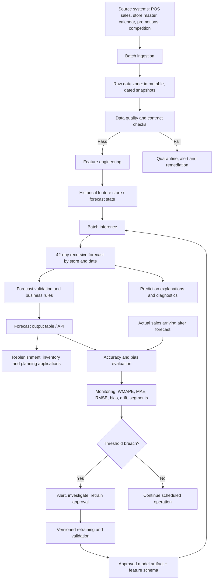

# Production Architecture — Rossmann Store Sales Forecasting

The diagram describes a proposed batch production design. Components such as orchestration, object storage, model registry, monitoring and serving are deployment recommendations; they are not claims that those services were implemented in this assignment.

## Component responsibilities

1. **Ingestion and raw zone:** collect dated sales, store, calendar, promotion and competition snapshots; preserve lineage and source timestamps.
2. **Data quality:** enforce unique Store-Date keys, valid dates and store identifiers, opening-status checks, missingness rules and schema compatibility. Quarantine failed batches.
3. **Feature engineering:** create calendar, promotion, competition and historical sales features using only information available at the forecast origin. Keep the training-selected 33-feature schema fixed at inference.
4. **Forecast state:** maintain per-store historical sales state. Generate lag/rolling features one date at a time and append predictions recursively; never use future actual sales.
5. **Model registry:** version model binary, feature schema, training cutoff, hyperparameters, code revision and validation evidence as one release unit.
6. **Batch inference:** score all stores for 42 dates, assign zero for closed stores, validate finite/non-negative outputs and enforce complete Store-Date coverage.
7. **Consumption:** publish forecasts with store, date, model version and generation timestamp to replenishment and planning systems.
8. **Monitoring and feedback:** when actuals arrive, calculate network/store/segment accuracy, directional bias, promotion performance and data/model drift. Trigger investigation or an approved retraining workflow.

## Operational release gates

- Reproducible training and inference from versioned inputs and code.
- Data contract and Store-Date completeness checks.
- Forecast sanity checks and non-negative predictions.
- Store-level and promotion-segment performance thresholds.
- Explicit business review of positive bias and asymmetric stockout/holding costs.
- Shadow run and sign-off before forecasts drive replenishment.
