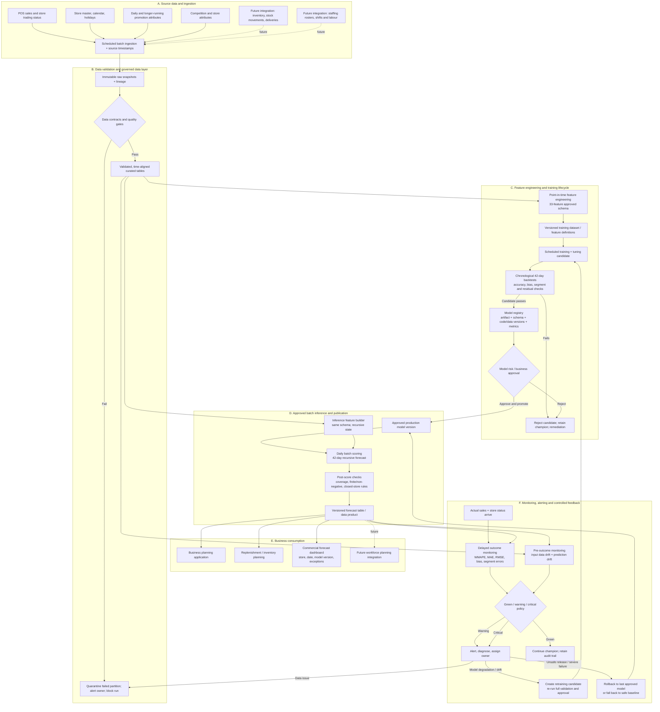

# Production Architecture — Rossmann Store Sales Forecasting

## 1. Design intent and operating mode

This is a proposed production design for the selected tuned LightGBM model. It extends the assignment implementation into a governed forecasting service; the registry, orchestration, approval workflow, monitoring, and application integrations below are **design recommendations, not services already deployed or implemented in this assignment**.

**Inference mode: batch, not real time.** Store sales are forecast at a daily grain, and the model uses historical sales lags and rolling statistics with a recursive 42-day forecast horizon. A synchronous real-time API is not justified for this use case: forecasts are planning inputs, not per-customer interactive predictions.

- **Forecast generation:** daily overnight batch after the previous trading day's POS sales and store status have landed and passed validation. Generate a rolling 42-calendar-day forecast for every store.
- **Retraining:** scheduled quarterly, using the latest eligible historical data and a chronological validation design. Evaluate actuals and drift monthly. A material data/process change or sustained critical degradation can trigger an out-of-cycle retraining candidate; it does not bypass approval.
- **Forecast consumption:** publish a versioned forecast dataset to planning and replenishment applications. Applications can consume the latest approved batch; downstream order or staffing decisions remain subject to business rules and human review.
- **Feedback loop:** compare forecasts with actual sales as they become available, respecting store closures and the evaluation population used for each metric.

## 2. High-level architecture

## 3. Component responsibilities and controls

| Stage | What happens | Key controls / evidence |
|---|---|---|
| Ingestion | Land daily POS sales, open/closed status, store master, calendar, promotion and competition data as timestamped snapshots. | Source freshness, arrival completeness, schema version, immutable raw copy and lineage. Inventory and workforce feeds are future integrations, not current model inputs. |
| Data validation | Validate each source and the joined Store-Date grain before feature creation. | Unique Store-Date key; valid store/date; expected date coverage; valid sales and open-state semantics; missingness and domain checks; reject/quarantine failed partitions. Never silently train or score on a failed feed. |
| Feature engineering | Build calendar, store, promotion, competition and historical-sales features using only information available at the forecast origin. | Enforce the approved 33-feature contract, data types and category handling. Generate lag/rolling features recursively from prior actuals and then predictions; do not leak future actual sales. |
| Training | Train a candidate on the latest eligible history; use time-ordered validation and recursive 42-day backtests. | Record data cutoff, code commit, parameters, random seeds, feature schema, metrics and segment results. Keep a reproducible champion/challenger comparison. |
| Model registry | Store immutable model artifacts and their complete release metadata. | Version model binary, feature schema, training cutoff, source snapshot IDs, code revision, parameters, evaluation report, SHAP/explainability evidence and approval state. |
| Approval and promotion | A candidate is promoted only after technical and business gates pass. | Independent review of validation performance, bias, store/segment failures, data compatibility and operational readiness. Promote by version/alias; preserve previous approved champion for rollback. |
| Batch inference | Run daily overnight, generating a rolling 42-day forecast per store. | Load only the approved model; use the same feature contract; recursively append predictions; set closed-store forecasts to zero; validate complete Store-Date coverage, finite values, non-negative values and forecast timestamp/model version. |
| Business application | Publish forecasts to planning dashboards and replenishment workflows. | Show forecast horizon, store/date, model version, generation time, confidence/exception indicators where supported. Forecasts inform decisions; they must not automatically become purchase orders without inventory constraints and business approval. |
| Monitoring | Monitor data and prediction distributions immediately; monitor forecast quality after actuals arrive. | Network and store-level metrics, promotion/store-format segments, bias, feature drift, prediction drift, feed health, run latency and failure rates. Alerts create owned incidents and auditable actions. |

## 4. Monitoring definitions and thresholds

Thresholds below are **proposed initial pilot operating limits**, not thresholds learned from the two assignment holdouts and not evidence of a live monitoring system. Establish a stable reference period from approved training/validation data, then calibrate these limits with business owners during shadow operation. Evaluate by network and important segments (store, StoreType, promotion status); do not let a healthy network average hide a failing segment.

### 4.1 Data quality and freshness — hard release gates

| State | Proposed condition | Required action |
|---|---|---|
| Green | All mandatory feeds arrive within the agreed SLA; schema and key checks pass; Store-Date coverage is complete; missingness stays within the documented contract. | Continue feature generation and inference; log batch-level quality statistics. |
| Warning | A non-critical feed is delayed but within an agreed grace period, or a non-blocking distribution/missingness check moves outside its normal range without breaking the feature contract. | Alert the data owner; investigate; proceed only if the affected field is explicitly approved as non-blocking and inference remains valid. |
| Critical | Mandatory POS/store-status feed is stale or absent; schema/key contract breaks; duplicate or missing Store-Date records; invalid values; or required model features cannot be constructed reliably. | Block training/inference publication; quarantine the partition; alert data owner and operations; use the last valid forecast only if its age is clearly labelled and business-approved, otherwise invoke the agreed fallback planning process. |

### 4.2 Input data drift

Monitor numeric and categorical model inputs by comparing the current scoring population with a fixed approved reference population. Use Population Stability Index (PSI) for suitable binned numeric features and category-share changes for categorical features. Monitor each feature and the proportion of features breaching limits; a drift alert is a prompt to investigate, not proof that accuracy has deteriorated.

| State | Proposed PSI per feature | Required action |
|---|---:|---|
| Green | < 0.10 | Continue normal scoring; retain trend history. |
| Warning | 0.10 to < 0.20 | Alert the ML/data owner; identify changed sources, seasonality, store mix or promotion mix; inspect affected features and segments; increase performance review frequency. |
| Critical | ≥ 0.20 on a key feature, or ≥ 20% of monitored features breach 0.20 in a run | Block automatic model promotion; investigate source/process changes and feature validity; run a challenger/retraining assessment. If the shift makes inputs unreliable, stop publication and use the approved fallback. |

For categorical features, apply the same state bands to a documented distribution-distance measure or use an agreed category-share absolute-change limit; do not calculate PSI by treating category labels as ordered numbers. Seasonality and planned promotion-calendar changes must be distinguished from data defects.

### 4.3 Prediction drift

Compare the distribution of daily forecast sales and relevant summaries (store-level forecast totals, zero/closed-store share, forecast quantiles and store/format segments) with a seasonally comparable approved reference. Use PSI on forecast distributions where appropriate and separately monitor operational invariants.

| State | Proposed PSI on forecast distribution | Required action |
|---|---:|---|
| Green | < 0.10 and operational invariants pass | Publish forecasts and retain monitoring records. |
| Warning | 0.10 to < 0.20, or a material but explainable change in forecast mix | Inspect store mix, promotion/calendar inputs, closures and recent actual demand; compare segment-level changes; keep publication under review. |
| Critical | ≥ 0.20, unexplained extreme forecast shift, invalid values, or material violation of forecast coverage/closed-store rules | Hold publication; investigate pipeline/model; rerun after correction or rollback to last approved model/fallback. Retraining is considered only after ruling out upstream data defects. |

### 4.4 Forecast performance after actuals arrive

Calculate performance only when actual sales have matured for the forecast dates. Use the same open-store evaluation population and metric definitions as the evaluation report; report WMAPE, MAE, RMSE and signed bias at network, store and segment levels. The limits below are proposed pilot guardrails informed by the observed 7.82% and 8.56% WMAPE holdout results; they must be calibrated against business tolerance and seasonal variation.

| State | WMAPE (network and material segments) | Absolute signed bias* | Required action |
|---|---:|---:|---|
| Green | ≤ 10% | ≤ 2% | Continue champion; review weekly and retain monthly segment report. |
| Warning | > 10% to 12% | > 2% to 4% | Alert model owner and planning lead; investigate error by store, StoreType, promotion and sales level; review bias and replenishment exposure; prepare a challenger if persistent. |
| Critical | > 12% | > 4% | Escalate; review whether forecasts remain fit for planning; apply human review/guardrails or revert to last approved model/fallback; initiate retraining candidate and full approval workflow. |

*Signed bias is calculated as (total predicted sales − total actual sales) / total actual sales over the defined evaluation population. Positive values indicate over-forecasting; negative values indicate under-forecasting. Evaluate both the network aggregate and material segments so offsetting over- and under-forecast errors do not conceal local failures.

A single anomalous day should trigger investigation, not automatic retraining. As an initial persistence rule, a warning requires two consecutive completed daily scoring/evaluation cycles or a clear segment-level business incident; a critical performance breach on two consecutive matured evaluation runs triggers formal escalation. Data-contract failures and invalid output invariants are immediate hard stops and do not wait for persistence.

## 5. Retraining, approval and rollback policy

1. **Scheduled refresh:** create a quarterly training candidate using the latest eligible actual sales and point-in-time features. Keep the forecast horizon and recursive validation protocol consistent with the deployed use case.
2. **Monthly health review:** review matured forecast metrics, signed bias, store/segment exceptions, input drift, prediction drift, feed quality and changes to store/promotion mix.
3. **Event-triggered candidate:** consider out-of-cycle retraining after a material business/data change or sustained critical drift/performance degradation. First determine whether the cause is a broken feed, changed definition, unusual seasonality or genuine demand change; retraining does not repair bad inputs.
4. **Candidate evaluation:** compare against the current champion and a simple fallback on at least two chronological, recursive 42-day windows where data permits. Check WMAPE, MAE, RMSE, signed bias, segment performance, forecast sanity, stability and explainability.
5. **Approval:** require ML owner sign-off for technical quality and data/feature compatibility, plus planning/commercial owner sign-off for operational suitability and bias implications. Record approver, evidence, model version and effective date.
6. **Canary/shadow release:** run the candidate in shadow against the champion before promotion. Compare forecasts and downstream planning impact without automatically changing orders.
7. **Rollback:** retain the last approved model and feature contract. If a promoted model or pipeline produces invalid forecasts or critical degradation, stop publication, revert the model alias and/or pipeline version, and notify application owners. Use a documented baseline/manual planning fallback if the last approved release is not safe.

## 6. Important implementation notes and limitations

- The assignment implementation is a local, reproducible forecasting workflow; this architecture is a proposed deployment design. It does not imply that cloud orchestration, a feature store, a model registry, online serving, monitoring dashboards or production integrations currently exist.
- The current model is store-day level. Customer-level attributes, granular promotion mechanics, SKU inventory and staffing data are proposed enrichment streams for subsequent commercial analysis and decision support; they are not inputs to the current 33-feature model.
- Customer counts were available historically for EDA but not in the competition test data and were therefore excluded from model features. Do not introduce them into production inference without a reliable point-in-time feed and a retrained/revalidated model.
- Inventory replenishment and workforce scheduling require additional optimisation logic, constraints and outcome measurement. A sales forecast alone is not an order quantity or a staffing schedule.
- Thresholds are initial operational guardrails for a controlled pilot. Establish seasonally comparable reference distributions, validate alert sensitivity, and agree business tolerances before production enforcement.

## 7. Production readiness checklist

- [ ] Source ownership, freshness SLAs and data contracts agreed.
- [ ] Raw snapshots, lineage and reproducible feature pipeline implemented.
- [ ] Training/inference feature parity and recursive leakage tests automated.
- [ ] Model registry contains artifact, schema, code/data lineage and evaluation evidence.
- [ ] Technical and business approval workflow with immutable audit trail implemented.
- [ ] Daily batch inference, output validation, publication and failure handling tested.
- [ ] Monitoring for data quality, data drift, prediction drift and delayed performance operational.
- [ ] Green/warning/critical alerts routed to named owners with runbooks.
- [ ] Champion rollback and safe fallback process tested.
- [ ] Shadow pilot and success measures agreed before forecasts influence replenishment or staffing decisions.
