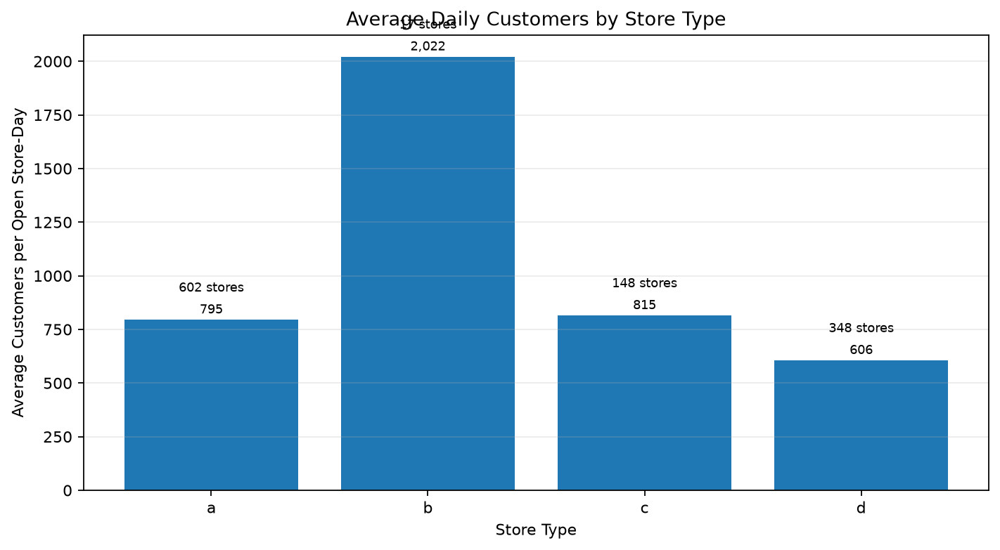
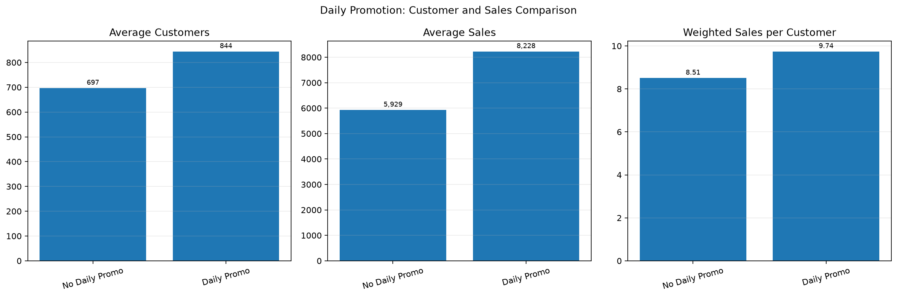
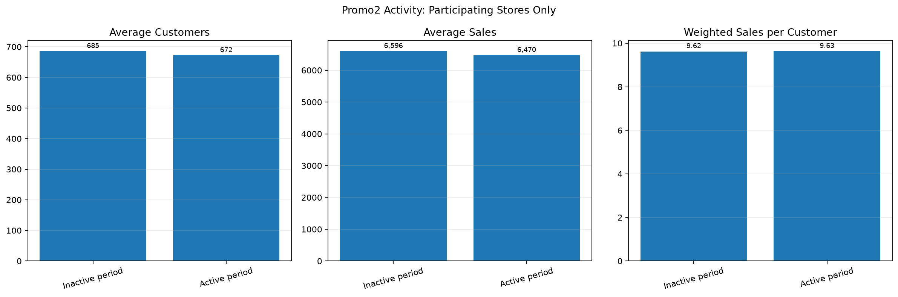
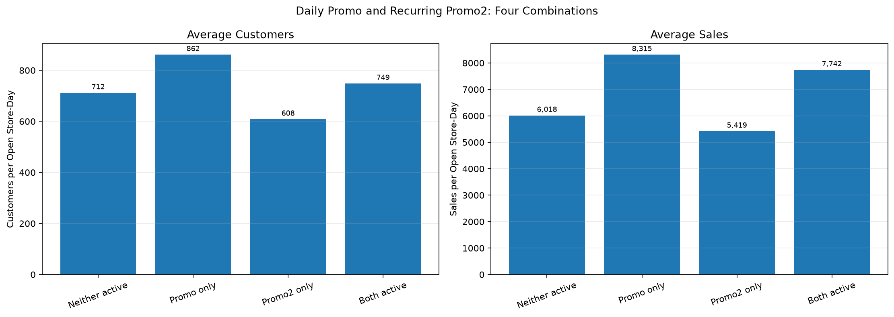
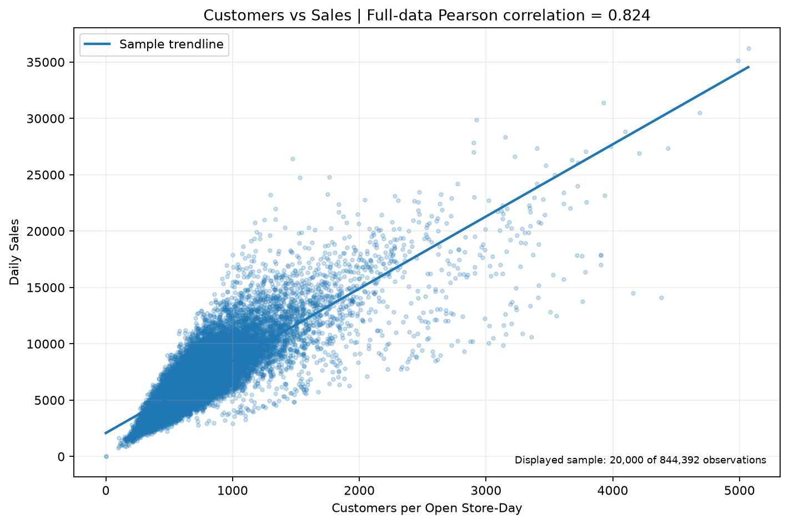

# Rossmann Customer and Promotion EDA

## 1. Objective and scope

This analysis investigates how customer footfall and sales vary across store characteristics and promotion conditions. It supplements the overall sales EDA with customer-level insight.

The analysis is descriptive. It identifies patterns and associations; it does not establish that a promotion caused a change in sales or customers.

## 2. Data sources and analysis population

- Training data: `data/raw/train.csv`.
- Store metadata: `data/raw/store.csv`.
- Join: both datasets are joined using the `Store` column.
- Join validation: many training store-day records to one store metadata record.
- Analysis grain: one record per store per date.
- Enriched source records: 1,017,209.
- Distinct stores: 1,115.
- Eligible open store-day observations: 844,392.
- Customer and sales comparisons include records where Open = 1 and Customers is available.
- Closed store-days are excluded from customer behaviour comparisons.
- No customer values are imputed.

The source CSV retains all original training observations, including closed store-days. The open-store filter is applied only when calculating customer and sales comparisons.

## 3. Columns and derived fields

| Field | Source / derivation | Purpose |
|---|---|---|
| Store | train.csv and store.csv | Store identifier and join key |
| Date | train.csv | Calendar and promotion timing |
| Open | train.csv | Identifies open store-days |
| Customers | train.csv | Daily customer count |
| Sales | train.csv | Daily sales outcome |
| StoreType | store.csv | Store format comparison |
| Assortment | store.csv | Assortment comparison |
| Promo | train.csv | Daily promotion flag |
| Promo2 | store.csv | Recurring programme participation |
| Promo2SinceYear / Week | store.csv | Recurring programme start date |
| PromoInterval | store.csv | Months associated with recurring programme |
| Promo2_Start_Date | Derived | Monday of the specified ISO week |
| Promo2_Active | Derived | Participation, start-date and active-month conditions |
| Promotion_Combination | Derived | Daily Promo and Promo2_Active combination |
| CompetitionDistance | store.csv | Distance to nearest competitor |
| Competition_Distance_Band | Derived | Groups competition distance into bands |
| CompetitionAgeMonths | Derived | Months since competitor opening, where metadata exists |
| Sales_per_Customer | Derived | Store-day sales divided by customers when customers > 0 |

## 4. Calculation methodology

### 4.1 Common aggregation rules

- **Observations:** number of eligible store-day records in each group.
- **Unique stores:** number of distinct Store identifiers represented in each group.
- **Total customers:** sum of Customers across eligible records.
- **Average customers:** total customer count divided by eligible store-day observations.
- **Median customers:** middle customer count across eligible store-day observations.
- **Total sales:** sum of Sales across eligible records.
- **Average sales:** total sales divided by eligible store-day observations.
- **Median sales:** middle sales value across eligible store-day observations.

These averages are store-day averages. They do not give every store equal weight: stores with more eligible observations contribute more records.

### 4.2 Sales per customer

**Average daily sales per customer** uses Sales and Customers for each eligible store-day. It calculates the sales-to-customer ratio for each store-day where Customers is greater than zero, then averages those ratios. Store-days with zero customers are excluded from this particular measure because division is not meaningful.

**Weighted sales per customer** divides the total Sales of the group by the total Customers of the same group. It represents the overall sales per customer across all included store-days and gives more weight to store-days with more customers.

These two measures are different and should not be used interchangeably. Weighted sales per customer is the primary group-level spending measure in the promotion comparisons.

### 4.3 Customer volume by store type

- Columns: StoreType, Open, Customers, Store.
- Filter: open store-days with a recorded customer count.
- Grouping: StoreType.
- Calculation: average Customers across eligible store-days in each type.
- Supporting context: distinct store count and observation count are reported.

### 4.4 Customer volume by assortment

- Columns: Assortment, Open, Customers, Store.
- Filter: same eligible open store-day population.
- Grouping: Assortment.
- Calculation: average and median Customers, with totals and store counts.

### 4.5 Daily promotion comparison

- Columns: Promo, Open, Customers, Sales.
- Filter: eligible open store-days.
- Grouping: Promo = 0 and Promo = 1.
- Calculation: average customers and average sales per eligible store-day, plus weighted sales per customer.
- Percentage difference: the Promo = 1 group value is compared with the Promo = 0 group value; the difference is divided by the Promo = 0 value and expressed as a percentage.

This is an unadjusted comparison. Promotion days may differ from non-promotion days in calendar timing, store mix and other conditions.

### 4.6 Promo2 participation comparison

- Columns: Promo2, Open, Customers, Sales.
- Filter: eligible open store-days.
- Grouping: Promo2 = 0 versus Promo2 = 1.
- Calculation: average customers, average sales and weighted sales per customer.

This compares stores participating in the recurring programme with stores not participating. It is not an active-versus-inactive comparison within the same participating stores.

### 4.7 Promo2 active versus inactive comparison

- Columns: Promo2, Promo2_Active, Open, Customers, Sales.
- Filter for the active/inactive comparison: Promo2 = 1 only.
- Grouping: Promo2_Active = 0 versus Promo2_Active = 1.
- Calculation: average customers and sales per eligible store-day, plus weighted sales per customer.
- Percentage difference: active-period average compared with inactive-period average, using the inactive-period average as the reference.

Non-participating stores are not treated as participating stores with an inactive promotion. The participation flag is retained in the analysis.

### 4.8 Four promotion combinations

- Columns: Promo and Promo2_Active, with Open, Customers and Sales.
- Filter: eligible open store-days.
- Grouping: both promotion flags together.
- Categories: neither active, daily Promo only, Promo2 only, and both active.
- Calculation: average customers and average sales for each combination.

The 'Promo2 not active' groups can contain both non-participating stores and participating stores in inactive periods. They must not be interpreted as only participating stores with inactive promotions.

### 4.9 Promotion by store type, assortment and weekday

- Columns: StoreType or Assortment or DayOfWeek, Promo, Open, Customers and Sales.
- Filter: eligible open store-days.
- Grouping: each selected store characteristic together with daily Promo.
- Calculation: the same common aggregation measures are calculated within each group.

These breakdowns help identify whether the overall daily promotion pattern is consistent across different store categories and weekdays.

### 4.10 Promo2 by store type and combined promotion detail

- Columns: StoreType, Promo, Promo2_Active, Open, Customers and Sales.
- Filter: eligible open store-days.
- Grouping: store type and the relevant promotion flags.
- Calculation: average customers, average sales, totals, medians and weighted sales per customer.

These tables provide more detailed context for differences in store composition and promotion conditions.

### 4.11 Competition distance

- Columns: CompetitionDistance, Competition_Distance_Band, Open, Customers and Sales.
- Filter: eligible open store-days.
- Grouping: competition distance band.
- Calculation: customer and sales aggregation within each distance band.

Distance bands are descriptive groupings. Missing competition distances remain a separate missing group rather than being assigned an invented distance.

### 4.12 Store-level customer-sales relationship

- Columns: Store, StoreType, Assortment, Promo2, Open, Customers and Sales.
- Filter: eligible open store-days.
- Grouping: Store.
- Calculation: average customers and average sales across each store's eligible open days, alongside totals and number of open days.

This creates one summary record per store. It is used to examine whether stores with higher average customer volume also tend to have higher average sales.

### 4.13 Customer-sales correlation

- Daily correlation: Pearson correlation between Customers and Sales across all eligible open store-day observations.
- Store-level correlation: Pearson correlation between each store's average Customers and average Sales.
- Correlation ranges from -1 to +1. Positive values indicate that higher customer counts tend to occur alongside higher sales; values closer to +1 indicate a stronger positive linear relationship.

The two correlations answer different questions. The first is based on individual store-days; the second compares store averages.

## 5. Promo2 date interpretation and assumptions

The Promo2 start year and week are converted to the Monday of the corresponding ISO calendar week. A participating store is marked active only when the observation date is on or after that start date and its calendar month appears in PromoInterval.

The active-month list is interpreted as recurring in subsequent years after the start date. This is an analytical assumption that should be confirmed with the business owner or dataset documentation before operational use.

A missing or invalid start date or missing PromoInterval for a participating store prevents that record from being classified as active. Such records are flagged through Promo2_Metadata_Missing.

## 6. Visual findings

### Chart 1: Average customers by store type

Shows average customers per open store-day for each store type. Store counts are annotated to make the size of each group visible. A high average for a small store group should not automatically be generalised to the full store population.

### Chart 2: Daily promotion comparison

Compares average customers, average sales and weighted sales per customer between daily promotion and non-promotion store-days.

### Chart 3: Promo2 active versus inactive

Compares participating stores only, separating their active and inactive recurring-promotion periods.

### Chart 4: Four promotion combinations

Compares average customers and average sales across the four combinations of daily Promo and Promo2 activity.

### Chart 5: Customers versus sales

Displays a reproducible random sample of up to 20,000 open store-day observations for readability. The reported Pearson correlation is calculated using the full eligible open store-day dataset, not just the displayed sample. The trendline is fitted to the displayed sample.

## 7. Findings

### Customer volume by store type

**Observation:** StoreType b has the highest average daily customers (2,021.8), across 17 stores.

**Interpretation / limitation:** Store groups differ in size and composition; the result is descriptive.

### Daily promotion association

**Observation:** Promo=1 versus Promo=0: average customers +21.2%; average sales +38.8%; weighted sales per customer +14.5%.

**Interpretation / limitation:** Unadjusted comparison; this is not a causal estimate of promotional uplift.

### Recurring promotion activity

**Observation:** Among participating stores, active versus inactive Promo2 periods show average customer difference -2.0% and average sales difference -1.9%.

**Interpretation / limitation:** Seasonality, store mix and promotion timing may influence this comparison.

### Customer-sales relationship

**Observation:** Daily Pearson correlation: 0.824; store-level Pearson correlation: 0.830.

**Interpretation / limitation:** Correlation is not causation. Actual Customers is unavailable in test and will not be used as a forecasting input.

## 8. Customer-sales relationship and forecasting implications

- Daily open store-day Pearson correlation: 0.824 (844,392 observations).
- Store-level average Pearson correlation: 0.830 (1,115 stores).

The positive relationship indicates that customer volume is informative when explaining historical sales. However, Customers is absent from the competition test dataset and is not available at the time the forecast must be generated. It is therefore excluded from model inputs. It is used here for retrospective analysis and interpretation only.

## 9. Limitations and interpretation safeguards

- These are descriptive comparisons, not controlled experiments.
- Promotion timing, seasonality, weekday effects and store characteristics may influence the observed results.
- Store-day averages give more weight to stores with more eligible observations.
- Store groups differ substantially in their number of stores.
- Correlation does not demonstrate causation.
- Promo2 activity depends on the stated ISO-week and recurring-month assumptions.
- Sales per customer is undefined for store-days with zero customers.
- Actual Customers is unavailable in the test data and is excluded from forecasting features.

## 10. Reproducibility and output files

- Source dataset: `data/processed/customer_eda_source.csv`.
- Numerical summaries: `reports/customer_eda_summary.xlsx`.
- Charts: `reports/customer_eda_charts/`.
- Script: `src/preprocessing/customer_eda.py`.

All reported tables and charts are generated from the same enriched training source and the same open-store-day analysis population.

